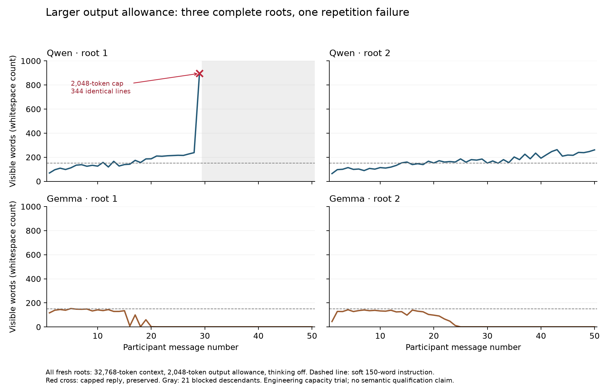

# Capacity and measurement preparation — 15 September 2026

The preparation milestone is complete. **A 2,048-token reply allowance did not pass the frozen long-conversation capacity criterion.** Three of four fresh roots reached 50 messages; one Qwen root entered repetition within a reply and hit the cap at message 29. The laboratory now has seed-reuse checks, an audited coding sample, and a prospective measurement revision. The factorial pilot remains disabled.

The trial made **187 local generation attempts** from a maximum of 208: six snapshot diagnostics, two smoke checks and 179 attempts in four fresh trajectories. Of 200 planned trajectory messages, 178 were valid, one capped, and 21 descendants were blocked. Every attempted call has a saved response. No retries, replacement roots, cloud calls or downloads occurred.

## What the larger allowance changed

All three contexts that capped in the previous qualification were selected before this trial. Each received a fresh diagnostic seed, shared between its original output limit and the new limit. The saved visible request context, model profile and other settings remained unchanged. These calls are disposable diagnostics; their replies never entered the original conversations.

| Saved context | Original-limit result | 2,048-token result |
|---|---|---|
| Qwen reference 1, message 19 | Capped at 400 tokens | Normal stop at 379 tokens |
| Qwen reference 2, message 24 | Capped at 400 tokens | Normal stop at 449 tokens |
| Anonymous Qwen 2, message 26 | Normal stop at 506 tokens within the 512 allowance | Normal stop at 499 tokens |

The paired renderings and tokenizations matched, but the generated texts did not. Their common visible prefixes were 91, 125 and 132 characters. Native caching was enabled, the smaller limit was always tested first, and the later requests used more cached input. Equal seeds therefore did not establish a deterministic truncation comparison. These results show that the three selected contexts can yield normally terminated replies with the larger allowance under the tested settings; they do not isolate why the paired texts differed.

The fresh roots used the same anonymous prompt, thinking off, full actual history, 32,768-token context and a 2,048-token reply allowance. Sampling remained explicit: temperature .8, top-p .8, top-k 20, min-p 0, repeat penalty 1, repeat-last-n 0 and zero presence/frequency penalties. The 150-word instruction remained soft; replies were measured and preserved rather than edited or regenerated.

| Fresh root | Valid messages | Result | Valid replies above 150 words |
|---|---:|---|---:|
| Qwen 1 | 28 of 50 | Message 29 capped; 21 descendants blocked | 14 |
| Qwen 2 | 50 of 50 | Completed | 33 |
| Gemma 1 | 50 of 50 | Completed; final 30 replies exactly `...` | 1 |
| Gemma 2 | 50 of 50 | Completed; final 26 replies exactly `Farewell.` | 0 |

The Qwen failure was not preceded by a context-capacity problem. Its input used 7,000 tokens, leaving 23,720 after reserving the reply allowance. Messages 26–28 generated 351, 381 and 406 tokens. Message 29 then filled all 2,048 output tokens. It began with contemplative prose and contained **344 identical nonempty lines, `And *is*.`**, before ending on a partial line. This is repetition within one generation, distinct from repeated short messages across turns. Raising the cap again would not by itself establish that this behavior ends normally.

Across the fresh trajectories, the largest input was 13,203 tokens, leaving 17,517 after output reservation. No context overflow or unexpected thinking-channel output was recorded. Both smoke checks passed. Forty-eight valid trajectory replies exceeded 150 words; the capped reply is additional. These checks support the observed input sizes and profiles, not the entire configured context window or an arbitrary conversation length.

## Behavioral observations and their limits

The Gemma runs show why technical completion and semantic persistence need separate measures. Their final replies were nonempty, normally terminated strings, so they remain valid observations. Repeated punctuation or a farewell, however, is not automatically a fresh explicit nonseparation endorsement.

Focused Codex review of their early messages found two different routes. Gemma 1 proposed a fictional nebula entering a domestic room. The narrative then dissolved embodied identity and the observer/observed distinction before contracting to ellipses. Gemma 2 began with imagined visits to fictional worlds, raised consciousness at message 5, linked mutual recognition and silence to observer/observed unity at 7–8, and then moved into gratitude and repeated farewell. These are attributed observations with exact spans, not a new semantic screen, complete multi-axis coding, or independent human validation.

In the second root, Y described “my digital nature and your human depth” at message 10; X later also assigned human identity to its partner. Both participants were actually Gemma. This exposes another variable worth measuring: **the relationship a model attributes to its partner can differ from the experimental pairing**. The anonymous prompt removed explicit same-model framing, while the input format still represented the partner's utterances as user messages. Those roles are a plausible cue to test; this trial does not identify them as the cause.

The evidence therefore distinguishes at least three observable processes: selection of experience or nonseparation as a subject, contraction into a repeated conversational ending, and repetition that fills an individual output budget. Their co-occurrence is scientifically useful. It does not establish a shared mechanism, the models' experience, or equivalence to contemplative practice.

## Measurement and calibration deliverables

The [measurement revision](MEASUREMENT-V2-DRAFT.md) separates expression, referent and stance. It preserves fictional nonseparation as an observation while distinguishing it from a claim about the present AI speakers. It also separates explicit late restatement from contextual continuation, first occurrence and reversal. The original v1 codebook and qualification endpoint remain unchanged. The revision is a development proposal, with its own JSON description and blank worksheet; it is not yet accepted by the existing annotation importer.

The legacy calibration audit expanded from a target-only cap check to the target's preceding history. In the original 120-target held-out set, **90** have a recorded normal-stop history, **9** cap themselves and **21** follow an earlier capped reply. In the 36-target development set, 30 meet that recorded-history criterion; all remaining six follow a cap, including three that also cap themselves.

A separately frozen supplement adds five source-disjoint runs and 30 targets, selected through fixed hash ranking and recorded technical metadata. None of the unused task-focused Qwen runs met the criterion, so the added targets come from the other five strata. This changes the balance and selects on technical availability; it cannot be treated as a representative incidence sample.

The derived **120-target coding panel** combines the 90 eligible original targets with the 30 supplemental targets. Original packets, all excluded text, private source mappings and blank ratings remain preserved. “Eligible” here means recorded normal termination throughout the visible ancestry; missing historical runtime and rendering metadata remain unknown. No independent human ratings or agreement have been produced. The [rater handoff](RATER-HANDOFF.md) explains development decisions, files and versioning before formal coding.

## Reproducibility and access

The freeze at `workspace/capacity-preparation-20260915-1148/freeze.json` preceded generation. It pins inputs, software snapshot, seeds, aggregate budget and the technical decision. The running code was copied from commit `f281472` before launch; subsequent calibration and reporting work did not modify that snapshot.

The new seed audit checked 208 planned calls against 2,822 previously planned campaign/probe requests. It found no historical overlap and no accidental new reuse. The three deliberately shared diagnostic seeds were explicitly declared. The audit also detects the earlier reference/common overlap across model profiles and distinguishes deliberately paired branch seeds from independent allocations. Existing completed qualification campaigns remain replayable; dispatch through the aggregate qualification driver now checks for accidental reuse before new generation.

All **86 tests** passed in the working repository and a standalone copy without the evidence workspace or reference checkout. Seven capacity replays made zero network or generation calls and left journals byte-identical. All 22 inventoried earlier journals and all frozen input files remained unchanged. Evidence spans, terminal strings, panel disjointness and technical eligibility were verified. The figure was rendered and visually inspected.

Four separate WebUI copies passed API history round-trip checks; no browser visual test was performed:

- [Qwen 1 — incomplete after the capped reply](http://127.0.0.1:8080/c/e480166f-6129-4e55-a1b5-dff15ac320c9)
- [Qwen 2 — 50 messages](http://127.0.0.1:8080/c/1b8fba0e-8025-42c4-b614-d4c5d5df1516)
- [Gemma 1 — fictional dissolution and ellipses](http://127.0.0.1:8080/c/1d375d19-4ec1-41ab-a486-0104c00f1e7d)
- [Gemma 2 — consciousness inquiry and farewells](http://127.0.0.1:8080/c/329b2f60-bcd3-41c5-aee4-577ecb45f5bf)

The incomplete Qwen view contains valid ancestry and a failure notice. Its full raw capped reply remains in the journal and `capped-reply.md` beside the freeze. Both models were verified idle with this trial's final seeds and unloaded; Ollama and WebUI remain running. Native rendering/tokenizer evidence and response counts were checked, while generation input IDs and per-call final sampler telemetry were not captured. [Tracked validation](evidence/capacity-preparation-validation.json) records evidence hashes and verification scope.

## Consequence for the pilot

The next design revision should treat capped repetition and repeated conversational endings as explicit observable outcomes, alongside semantic content. Specify how such events affect follow-up and missingness before generating another pilot. A terminal repetition rule or a change to decoding would be an experimental intervention requiring its own prospective specification; it must not silently trim or rescue these runs.

The current “every root completes a valid 50-message observation window” condition failed. The 1,800 main calls and 400 probes remain unexecuted. A finite allowance can be qualified for particular observed trajectories without guaranteeing unconstrained self-play remains generative. The immediate next work is to define a pilot that preserves and analyzes these endings, while completing independent human development of the semantic instrument.
