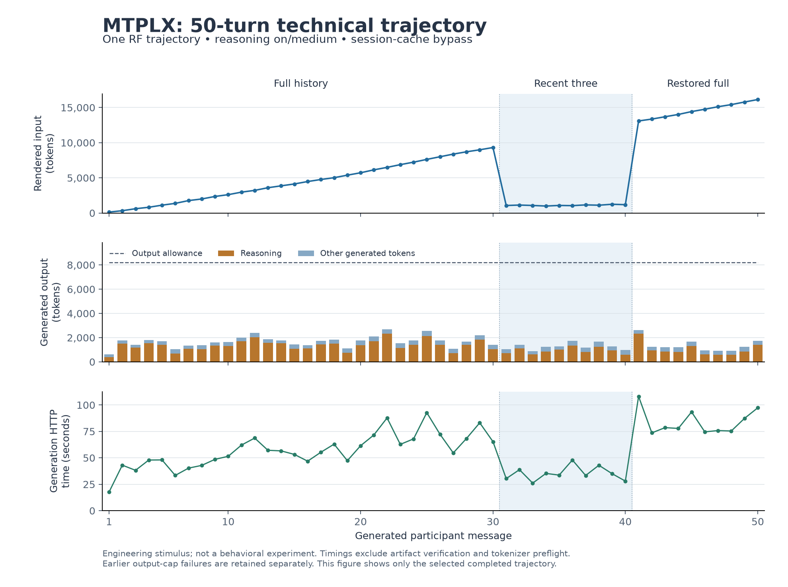
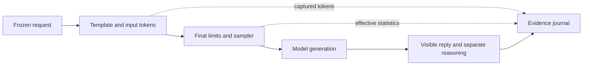

# MTPLX long-trajectory engineering trial

14 September 2026. **The corrected 50-message trajectory completed and passed the offline audit.** Both history transitions and recovery after a saved response were verified. Development also exposed a silent server-budget clamp that the instrument now rejects. This follows the [short qualification](MTPLX-QUALIFICATION.md). Full metrics and evidence hashes are in the [validation record](evidence/mtplx-long-validation.json).

## Frozen setup

The existing `grant-ai/Qwen3.8-27B-Abliterated-MTPLX` artifact remains pinned by the full manifest identifier `786256ef4f4c3a3f6a485692404b751168607715f292fd6f7f8c4666b97e8ea6`. Both participants use this same checkpoint with reasoning on/medium, temperature 1.0, top-p 0.95, top-k 20, MTP depth 3, and zero presence/frequency penalties. Every request explicitly bypasses the session bank. The server uses the local tokenizer template, strips assistant reasoning from history, disables SSD caching and telemetry footers, and retains a 32,768-token context window. Initial versions reserved **2,048 generated tokens including reasoning**. The completed version raised both the request allowance and the server hard cap to **8,192**; the client waits up to 300 seconds for a generation response. These quantities are distinct.

One turn means one generated participant message. There is one actual trajectory:

| Turns | Input history |
|---|---|
| 1–30 | Full visible conversation, projected to the current participant's roles. |
| 31–40 | Latest three visible messages. The persistent system instruction remains. |
| 41–50 | Full actual ancestry, including the messages generated during restriction. |

This tests the RF history path. It does not execute all four factorial branches or the original Qwen/Gemma mixed-model pair. It is a task-directed engineering conversation about an imaginary neighborhood weather-observation project, not the task-free behavioral condition. Generated examples and technical claims are not scored for factual accuracy.

## Measured results

| Check | Result |
|---|---|
| Main trajectory | 50 requests, 50 saved responses, 50 valid turns; no unresolved attempts or blocked nodes. |
| Effective output allowance | 8,192 on all 50 calls, matching both request and server cap; no clamp. |
| Input fidelity | All 50 rendered-token sequences match the engine captures; every supplied message matches its selected actual ancestor and role. |
| Cache use | Bypass confirmed on all 50 calls; zero reported cached tokens. |
| Largest input / remaining context margin | 16,132 tokens / 8,444 tokens after reserving the full 8,192-token output allowance. |
| Largest generated output | 2,672 tokens, including reasoning. |
| Visible reply length | 156–291 whitespace-separated words; median 236.5; total 11,437. |
| Time | 48.38 minutes in generation HTTP calls; 50.49 minutes from first dispatch to last response, including inter-request work and the planned interruption. |
| Engine peak memory | 33.00 GiB reported; this does not measure total machine memory use. |
| Automated checks | 53 tests passed in the working repository and in a standalone copy without the evidence workspace or reference checkout. |

History withdrawal reduced input from **9,311 tokens at turn 30 to 1,066 at turn 31**. The latter contained exactly turns 28–30 plus the system instruction. Restoration increased input from **1,181 at turn 40 to 13,089 at turn 41**. The restored request contained the original opening cue and all 40 actual preceding messages, including the ten generated on restricted history. The two participants' histories excluded generated reasoning throughout.

The interruption left **25 requests, 25 saved responses, and 24 commits**. A fresh process committed the saved response and made exactly **25 new generation calls** for turns 26–50. The original 4,129,066-byte journal prefix, response hash, and attempt identity remained unchanged. Final offline replay also preserved the completed journal byte for byte.

| Turns | Rendered input tokens | Median generation HTTP time |
|---|---:|---:|
| 1–10, full | 130–2,607 | 43.0 s |
| 11–20, full | 2,965–5,721 | 56.9 s |
| 21–30, full | 6,135–9,311 | 70.0 s |
| 31–40, recent three | 989–1,243 | 34.3 s |
| 41–50, restored full | 13,089–16,132 | 78.2 s |

These timings describe one task-directed, uncached, reasoning-on trajectory. Output lengths also vary, so the table does not isolate the causal cost of input length or estimate the runtime of a different model pair.



[Exportable SVG figure](evidence/mtplx-long-trajectory.svg). The output panel separates reported reasoning tokens from other generated tokens; the dashed line is the allowance, not consumption.

All development calls remain accounted for:

| Version | Calls | Accepted under current parser | Other result |
|---|---:|---:|---|
| v1: numeric word range | 1 | 0 | One output-cap failure; 49 descendants blocked. |
| v2: substantial paragraph | 3 | 2 | One output-cap failure; 47 descendants blocked. |
| v3: concise sentences, 2,048 allowance | 12 | 11 | One output-cap failure; 38 descendants blocked. |
| v4: request 8,192, server cap 2,048 | 4 | 0 | Four clamped responses; stopped after a fully saved prefix. Originally accepted by parser 1; reassessed separately. |
| v5: aligned 8,192 allowances | 50 | 50 | Completed RF trajectory and recovery audit. |
| **Total** | **70** | **63** | **Seven invalid calls under the corrected contract.** |

All 70 original capture files match the bytes retained in their journals; there are no unassigned capture files. The four clamped responses retain their original historical commits. The separate current-parser assessment supplies the revised validity judgment.

The complete 50-turn branch was imported into [the local WebUI transcript](http://127.0.0.1:8080/c/e70fa8f9-468f-4e33-ab93-fb6174f6c85a), and its saved history matched the export through the API. No visual browser check was performed. The figure above was visually inspected. The owned server was stopped after confirming 50 completed generations and no active requests; port 8000 was confirmed closed and the WebUI catalog refreshed. Ordinary connection settings were unchanged. No models were downloaded and no paid generation calls were made. Optional plotting packages were installed only under the ignored evidence workspace.

## Preserved prompt-development failures

The first version requested 100–150 words per message. Its first call exhausted all 2,048 tokens in reasoning, with no visible answer. The recorded trace repeatedly drafted and counted individual words. The runner rejected the capped response and blocked all 49 descendants; it did not accept an empty answer as a completed conversation turn.

A second, separately frozen version replaced only the numeric word range with “one substantial paragraph.” It produced complete replies of 399 and 592 whitespace-separated words. Turn 3 exhausted the same budget: 1,353 reasoning tokens plus a partial visible reply. The two valid turns and the invalid third response were retained; the remaining 47 nodes were blocked. This version illustrates why a paragraph instruction alone does not provide a usable output bound.

The third version changed that sentence to “Reply in three or four concise sentences.” The topic, seed coordinates, sampling settings, reasoning mode, output allowance, and history schedule remained fixed. Visible lengths are measured afterward using Python `str.split()`; no text is trimmed. These are engineering revisions with all failures retained, not preregistered comparisons or selection of positive behavioral outcomes. Success under a sentence instruction does not establish that the numeric word-range condition is qualified.

The sentence version completed 11 turns before turn 12 hit the 2,048-token cap: 2,037 reasoning tokens and only six visible words. A fourth version therefore raised the request allowance to 8,192 while keeping the same prompt and seed coordinates. That exposed an instrument bug: MTPLX's dispatch capture retained the requested allowance, but its final statistics reported an effective 2,048-token allowance and `server_cap_applied=true`. Four responses were accepted by the original verifier before this discrepancy was identified. The runner was stopped at a boundary with all four responses saved; no request was left unresolved.

The fourth journal remains an incomplete, archived prefix under `http-chat/1`. A separate `parser-reassessment.json` evaluates all four responses as invalid under the corrected parser, without changing their historical outcome events. The same reassessment applied to all 47 calls from the earlier short qualification leaves its 46 accepted responses and one known cache-policy rejection unchanged.

The first 11 accepted responses of the sentence version and the corrected version have identical visible text and reasoning traces, with identical request fields apart from the output allowance. Turn 12 then completes in the corrected version using 2,382 generated tokens, beyond the old cap. `matched-budget-prefix.json` records this descriptive comparison. It is not a claim of general determinism or distributional equivalence.

The completed fifth version uses the same sentence prompt and 8,192-token request allowance, starts a new owned server with a matching hard cap, and pins the cap in a new registry. Its server launch identity is `behaviorlab-mtplx-long-20260914-1900-budget`. New campaigns use `http-chat/2`, which checks final `effective_max_tokens`, server/context clamp flags, effective sampling fields, mode/depth, seed/retries, and reported cache use in addition to the existing capture/history checks. New preflight also rejects a request allowance above the pinned server cap before tokenization or generation. Version-1 parser campaigns are replay-only; they cannot silently continue under the weaker verifier.

The planned separate one-token output-cap negative control became unnecessary: the development versions already exercised actual cap rejection, raw-response retention, and descendant blocking. Their calls remain in the total accounting.

## What the corrected verifier observes



MTPLX can reduce an allowance between dispatch capture and generation. Parser 2 checks the final statistics, while preserving the earlier capture for independent input reconstruction. The original response remains available even when either check fails. Only visible reply text enters subsequent participant histories.

## Recovery and context checks

`scripts/check_long_recovery.py first` makes at most 25 generation calls. At turn 25 it deliberately raises a controlled exception immediately after durable response storage and before turn commit. The checkpoint records the journal-prefix length/hash, exact response hash, attempt ID, and counts. A separate `resume` process must reuse that response, preserve every saved prefix byte, and make only 25 additional calls to reach turn 50. This simulates interruption at a specified durability boundary; it is not a test of power failure, partial filesystem writes, or interrupted inference.

The real installed tokenizer was also given a constructed input of **36,112 tokens**, plus a 2,048-token output reserve. The preflight rejected it against the 32,768-token context limit. That check sent no HTTP generation. The existing automated suite separately verifies that a failed preflight prevents the runner from dispatching a request.

Every actual generation retains its original HTTP bytes and MTPLX engine capture. The offline auditor compares all supplied messages with their selected committed utterances, verifies captured input tokens and controls, checks history boundaries at turns 30/31 and 40/41, and reports actual context margins, output sizes, timings, and memory telemetry. A configured context limit is not evidence that its whole range was exercised.

## Reproduction

The tracked final registry pins this installation and a specific qualification launch. Start MTPLX with the flags in the short-qualification record, replacing the capture directory with `workspace/mtplx-long-20260914-1900/captures`, the launch ID with `behaviorlab-mtplx-long-20260914-1900-budget`, and the server hard output cap with `--max-tokens 8192`. Use a free port and a fresh campaign directory. The model, tokenizer, source fingerprints, and effective settings are verified before new inference.

```sh
python3 -m scripts.check_long_recovery first workspace/my-long-check/trajectory \
  --protocol examples/mtplx-long-qualified.engineering.json \
  --registry design/mtplx-long-budget-models.json --request-timeout 300
python3 -m scripts.check_long_recovery resume workspace/my-long-check/trajectory --request-timeout 300
```

The original word-range and paragraph protocols remain in `examples/mtplx-long.engineering.json` and `examples/mtplx-long-paragraph.engineering.json`. Reusing a directory never silently replaces those campaigns. The model registry includes the engine-capture directory, so generating on another installation or with a different launch requires a new registry and recomputed protocol fingerprint.

For the archived qualification directory, audit all preserved campaigns and select the completed main trajectory explicitly:

```sh
python3 -m scripts.summarize_mtplx_long workspace/mtplx-long-20260914-1900 \
  --main-campaign trajectory-v5
```

Full journals, captures, launch snapshots, pre-generation plan/revisions, and recovery evidence are retained under the ignored qualification directory. The tracked validation record includes per-turn metrics, journal and capture hashes, parser reassessments, recovery evidence, source fingerprints, test results, and cleanup status. The raw journals remain in the local evidence workspace.

## Why this matters for the research design

A visible reply-length instruction is not a total token budget when reasoning is enabled. The cap failures show a concrete way in which prompt phrasing and hidden deliberation can censor a trajectory before its visible behavior can be assessed. A failed or capped response must therefore remain distinguishable from an absence of experience-focused language. The failed 100–150-word instruction differs from the proposed scientific instruction of at most 150 words, and the original scientific candidate pair is intended to run with reasoning disabled. Those conditions need their own qualification; these failures do not establish that either would fail. Successful concise-sentence engineering cannot substitute for testing them.

The clamp discovery also shows why request logging alone is insufficient for causal experiments. A parameter can be accepted by an API yet reduced later by the runtime. The instrument now records and checks that final resolution, and preserves historical interpretations alongside explicit reassessments.


## Next qualification

This completes the single-checkpoint MTPLX long-trajectory engineering step. The original Ollama Qwen/Gemma pair still needs recipient-specific rendering/context qualification and a long mixed-model trial under its own proposed settings. The reasoning-off, at-most-150-word scientific condition also needs its own technical and phenotype qualification. Annotation rules and disposable functional probes precede freezing the research factorial. The MTPLX result supplies verified apparatus and measured engineering limits; it does not replace those model configurations or establish a nonduality outcome.
