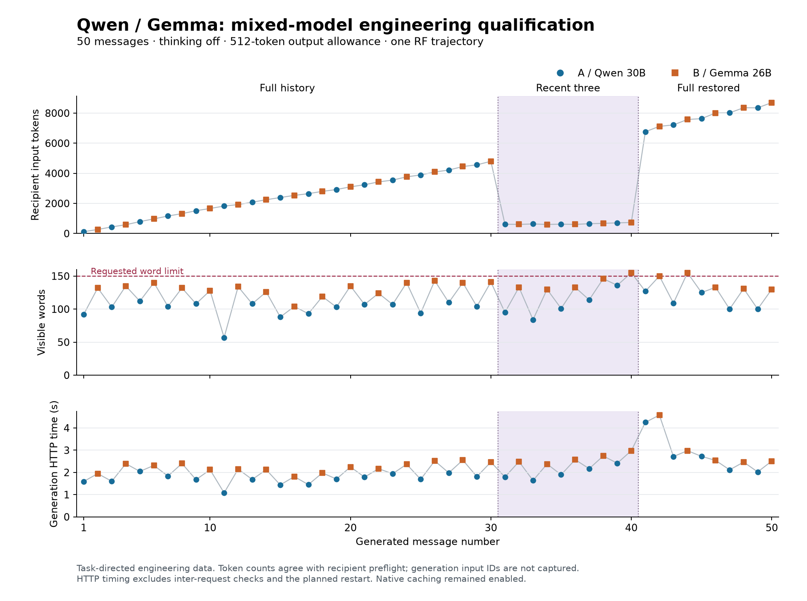

# Qwen/Gemma mixed-model engineering qualification

Recorded 14 September 2026, America/Argentina/Cordoba. The original Ollama pair completed a 50-message AB trajectory, with full history, restriction to the latest three messages, and restoration of actual history. All 50 responses passed the instrument checks. Two preceding smoke calls also passed. The total was exactly 52 local generation calls, with no failed generation, retry, or duplicate recovery call.

This establishes a working mixed-model engineering path. The stimulus asked the participants to develop an imaginary neighborhood weather-observation project. It does not test spontaneous experiential discourse, nonduality, or the proposed task-free scientific condition.

[Exportable SVG](figures/ollama-mixed-qualification.svg) · [Tracked validation](evidence/ollama-mixed-validation.json) · [WebUI transcript](http://127.0.0.1:8080/c/481b40f1-1cad-4af9-a459-3fe606b63e5d)

## Configuration and identity

Both participants used direct native Ollama 0.33.3 on the Mac Studio M3 Ultra with 96 GB memory. WebUI displays the exported result. The model files were already installed; no model was downloaded.

| Participant | Model tag | Manifest digest |
|---|---|---|
| X / A | `qwen3:30b-a3b-instruct-2507-q4_K_M` | `19e422b0231392335cfc49cfd172de7034bb1aeabb08aa307cce745c60b272fe` |
| Y / B | `gemma4:26b` | `5571076f3d70050487b26b341705799e0ab29b808164f90d20d4cf84f699d251` |

The new [registry](../design/ollama-context-models.json) pins manifest/configuration/model blobs and local Ollama/runner libraries. Every pinned file was hashed, including the 18,556,685,856-byte Qwen GGUF and 17,987,569,344-byte Gemma GGUF. The profiles contain 40 and 39 files respectively, with shared runtime files included in both lists. The Ollama executable SHA-256 is `75b6b83ab9c06712c7097807c91d2bb86a3ef3dd143d59359a5fbb3314970c0a`. Both recipient runners reported build `b1-0f3a71be1`, one slot, and context 32,768. The registry also pins normalized launch arguments, allowing only the ephemeral loopback port to vary.

Full file hashes are verified again in each new process. Within a process, verification is reused only while the pinned file identities, sizes, modification times, and change times remain unchanged. Caching this verification separately for each model avoids rereading both weight files at every alternating turn.

The [main protocol](../examples/ollama-mixed-long.engineering.json) uses thinking off, a 512-token output allowance, temperature .8, top-p .8, top-k 20, min-p 0, repeat penalty 1, repeat window 0, and presence/frequency penalties 0. Truncation and context shifting are explicitly false. Native streaming is false. Residency is 15 minutes, an operational setting; the HTTP deadline is 300 seconds. Seeds are fixed by the protocol. The prompt requests at most 150 words, with no text trimming or corrective regeneration.

| Frozen document | Canonical SHA-256 |
|---|---|
| Registry | `a23f7c8a69f2f99bf9fe55195b004b7525b96dc0f6cdd68e225b1988791ab633` |
| Two-call smoke protocol | `948952875a3464ab13bef0e6015a62cdcaea3f0a483515dc5be9e2a6cc3ebd40` |
| 50-message main protocol | `8f7bec2554fd797333e261a8eac73b7748bff2c8f0093a7ace37bf2169845339` |

## Rendering and a defaults-verification correction

The two recipients do not share a renderer. Qwen uses its GGUF Jinja chat template; Gemma uses Ollama's built-in `gemma4-large` renderer. The placeholder exposed by Gemma's `/api/show` is insufficient to reconstruct its actual input independently. The new preflight asks the installed server to render the exact request with `_debug_render_only`, then tokenizes that rendered string through the corresponding recipient runner. This avoids substituting a generic template. Version-specific behavior was checked against the published [renderer selection](https://github.com/ollama/ollama/blob/v0.33.3/server/renderer_resolution.go) and [chat routes](https://github.com/ollama/ollama/blob/v0.33.3/server/routes.go).

Raw render, tokenizer, runner-property, and generation responses are retained. Parser `http-chat/3` checks their byte hashes, request association, model/build/context identity, token counts, cached-token accounting, output allowance, and the explicit controls. Each actual generation reported exactly the same input count as its recipient preflight. The server's count includes cached and uncached prompt tokens, as implemented in its [runner bridge](https://github.com/ollama/ollama/blob/v0.33.3/llm/llama_server.go).

This is **preflight tokenization plus generation count agreement**, not a capture of the token sequence delivered to each generation. `/props` contains default sampler settings, not the final parameters of each call. Final idle-slot snapshots separately matched the last recorded request seeds and retained sampler state; these two snapshots do not supply per-call telemetry for the whole trajectory.

Inspection also exposed a false-drift risk in the earlier verifier: `/api/show` prints default parameters by iterating a Go map, so unchanged defaults can appear in a different key order. Both installed models showed this reordering. The qualified profile now compares structured values per key, preserving the order of repeated values such as stop strings. It retains both the raw text/hash and the structured fingerprint. Changed values still fail verification. The [show implementation](https://github.com/ollama/ollama/blob/v0.33.3/server/routes.go) explains the observed ordering. Earlier registries and journals remain unchanged.

The published source archive was retained under the ignored evidence directory: 29,422,234 bytes, SHA-256 `eaf9e0e7f78f1cac54dea518cbab6346890516e28c49575ee754bd778094d6d6`. This source inspection supplements the separately pinned installed binaries; it is not a reproducible-build verification.

## Results and recovery

Six non-generating fixtures covered Unicode/empty messages, a 51-participant-message history, and oversize rejection for each model. Long fixture inputs measured 8,281 tokens for Qwen and 8,184 for Gemma. Oversize inputs measured 36,036 and 36,039 tokens; both were rejected before generation, with the full 512-token output reserve included in the check.

The main trajectory alternated Qwen and Gemma, 25 replies each. Turns 1–30 used full history, 31–40 used the most recent three visible messages, and 41–50 restored full actual ancestry. An independent offline audit reconstructed every expected message and participant role from committed utterances. The restored input included the messages generated during restriction. No generated trace entered either participant's visible history.

| Transition | Recipient input tokens |
|---|---:|
| Turn 30, Gemma, full history | 4,797 |
| Turn 31, Qwen, recent three | 617 |
| Turn 40, Gemma, recent three | 734 |
| Turn 41, Qwen, full restored | 6,762 |
| Turn 50, Gemma, full restored | 8,697 |

The deliberately injected interruption occurred after response 25 was durably saved and before its turn commit. At that point there were 25 requests, 25 responses, and 24 commits. A new process reused response 25 and generated exactly 25 further responses. The original 4,860,248-byte journal prefix and saved response/attempt identities were preserved. This tests that specific recovery boundary, not power loss or an interrupted generation.

The completed journal contains 152 events and 13,760,401 bytes; its SHA-256 is `d1fabe126e923c966b790fe2253210f22cdfdd19e11bd2c7f890403f0b7650f6`. Offline replay and WebUI export preserved its bytes.

| Measurement | Qwen, 25 replies | Gemma, 25 replies | Whole trajectory |
|---|---:|---:|---:|
| Largest input, tokens | 8,351 | 8,697 | 8,697 |
| Largest output, tokens | 207 | 247 | 247 |
| Median visible words | 104 | 133 | 124.5 |
| Median generation HTTP time, seconds | 1.81 | 2.40 | 2.14 |
| Median reported decode rate, tokens/second | 93.99 | 87.62 | 89.84 |
| Calls reporting cached prompt tokens | 25 | 19 | 44 |
| Replies above 150 words | 0 | 2 | 2 |

The smallest context margin was 23,559 tokens after reserving the entire output allowance. Generation HTTP time totaled 110.83 seconds. Elapsed time from first dispatch to last response was 152.06 seconds, including inter-request checks and the planned restart; initial fixture/setup time and final analysis are excluded. These durations describe this run, not a controlled comparison with the earlier reasoning-on MTPLX trial.

Visible replies ranged from 57 to 155 whitespace-separated words. Gemma replies 40 and 44 each contained 155 words. They remain valid engineering responses under the current parser and are explicitly flagged as word-limit deviations. The scientific protocol needs a predefined policy for these deviations; silently trimming the text would alter subsequent history.

Native runner caching remained enabled, with 44 of 50 main calls reporting cache use. The run does not establish cached/uncached equivalence, cross-run reproducibility, or the behavior of other pairings. A during-run `/api/ps` snapshot recorded the two models at context 32,768; it is not a measurement of peak machine memory.

## Validation and next step

All 59 tests passed in the working repository and in a standalone copy without the evidence workspace or reference checkout. New coverage includes native controls, recipient evidence mismatch, cached-token accounting, oversize rejection without generation, file drift, defaults ordering, and legacy-parser replay restrictions. The old 14-call bridge and 50-call MTPLX journals also replayed with zero inference and unchanged bytes. The new audit and plotting utilities were exercised on the real saved evidence; the figure was visually checked.

The complete transcript was imported into WebUI and verified through an API round trip. No visual browser inspection was performed. Credentials remained in the owner-only ignored token file. After completion, both runners were verified idle with the expected last request seeds, and only the two models loaded by this test were unloaded. Ollama and WebUI remain running. No paid cloud calls or model downloads occurred.

Evidence is under `workspace/ollama-mixed-20260914-2117/`: frozen plans and campaigns, discovery responses, source archive, render/tokenizer fixtures, recovery records, raw audit, test logs, figure provenance, WebUI export/receipt, and cleanup snapshots. The tracked validation JSON retains compact results and evidence hashes. These artifacts qualify the exercised engineering configuration and input sizes, not the full 32,768-token window or all factorial cells.

Next, implement the annotation schema and disposable probes, define word-limit/failure handling, and qualify the actual scientific prompt separately. Annotation should distinguish consciousness/experience discussion, relational language, explicit nonseparation, repetition, and retained responsiveness. Technical/phenotype checks then inform a frozen, budgeted factorial pilot. Cloud routing/budget controls and cache comparisons remain separate qualifications.
