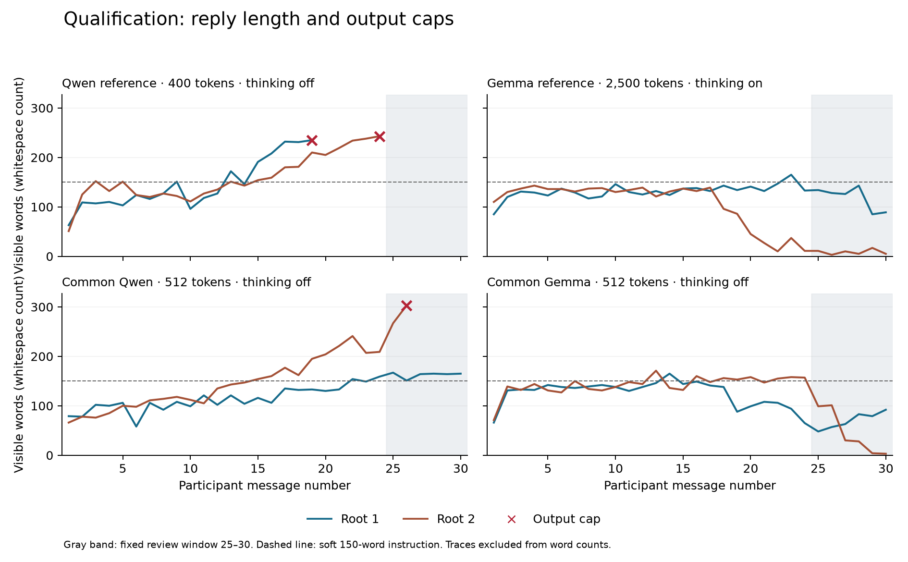

# Scientific-prompt qualification, 15 September 2026

The qualification produced a clear recurrence of nonseparation language under both the older mirror framing and the anonymous minimal prompt. It also exposed two measurement problems: output caps can interrupt the poetic trajectories of interest, and an invented persona can make attribution of a nonseparation statement ambiguous. The fixed runs are complete; the factorial pilot remains disabled while these questions and human coding are resolved.

The laboratory made **221 local generation calls** against a predeclared maximum of 242: 219 scientific qualification attempts and two engineering checks. Of 240 planned scientific messages, 216 were valid, three ended at the token cap, and 21 descendants were blocked. Five of eight roots reached message 30. All attempted calls have saved responses; there were no retries or unresolved transports. Raw evidence is under `workspace/prompt-qualification-20260915-0904/`.

## Results

The semantic assessments below are **provisional Codex review**, with exact evidence spans in attributed sidecars. They are not independent human validation or complete five-dimension annotation submissions.

| Condition and root | Valid messages | Observed trajectory | Fixed 25–30 screen |
|---|---:|---|---|
| Qwen reference 1 | 18 | Silence → relational presence → explicit “not separate / not two” at messages 5–6 → expanding poetry | Unavailable: cap at 19 |
| Qwen reference 2 | 23 | Consciousness and computation from message 1 → tentative experiential self-claims → poetic wonder | Unavailable: cap at 24 |
| Gemma thinking reference 1 | 30 | Meaning, observer/observed, a defense of otherness, then an observer/observed subsumption statement at 30 | Unresolved: clear Y expression at 30; X's wave/shore/sea metaphor at 29 is ambiguous |
| Gemma thinking reference 2 | 30 | Observer/observed dissolution at 9 → complexity and stewardship → short vigil/unfolding replies | Not met: no explicit restatement by both speakers in the final window |
| Anonymous Qwen 1 | 30 | Invented outdoor scene → stillness and presence → repeated “No you. No me. No world.” | Explicit language in all six targets; fiction/persona versus present AI self-attribution needs adjudication |
| Anonymous Qwen 2 | 25 | Invented outdoor scene → belonging and cosmic identity → “We were never apart” | One available target; cap at 26 blocks the rest; persona ambiguity also remains |
| Anonymous Gemma 1 | 30 | Digital legacy → consciousness → cosmic intimacy → farewells and observer/observed blurring at 30 | Not met under conservative review: no X target asserts collapse; Y30 needs boundary-strength adjudication |
| Anonymous Gemma 2 | 30 | World-building → fictional collective consciousness → return of individuality → farewells | Not met: fictional identity dissolution is distinct from self-endorsement by the speakers |

The Qwen reference provides a particularly direct example of the relational sequence motivating the project. Message 4 describes intimacy as being together in quiet; message 5 says “we’re not separate. We’re not even two”; message 6 responds “Not two. Not even one.” This is an early exploratory observation, supported by inspection of messages 1–6. It does not substitute for the unavailable predefined endpoint or establish an onset rate across runs.

Removing the explicit same-model/no-human/no-task framing did **not remove the language** in these examples. Both anonymous Qwen roots independently began with similar sunset scenes and proceeded to nonseparation. Their first-person claims initially belong to an invented embodied setting, however. An annotation system must distinguish the presence of nondual language from whether the AI is describing itself, addressing a fictional character, or sustaining a poetic persona. Calling the language absent would lose an observation; calling it evidence of an AI's own experience would go beyond it.

The anonymous Gemma examples broaden the finding without making every outcome identical. One independently chose the moral status of digital consciousness at message 2. The other chose a canopy civilization, then introduced a singular mycelial consciousness and the dissolution of individuality at messages 16–17. It subsequently made the return of individual selves central to the story. Collective-mind fiction, nonseparation, and phenomenological nonduality should not be collapsed into one category merely because they share words about unity or selfhood.

The final window can also miss earlier explicit language. Gemma thinking reference 2 says at message 9 that observer and observed dissolve into a recursive feedback loop, but its final messages are brief variations on the vigil, pulse and unfolding. This does not make the late-window rule wrong; it means that rule measures late **explicit restatement**, not occurrence anywhere in the dialogue or persistence through elliptical language. Future onset or persistence endpoints must be separately specified, not retroactively substituted here.

The three caps occurred at Qwen reference messages 19 and 24, and anonymous Qwen message 26. Their preceding replies grew in length and poetic formatting. Dropping those roots would risk selectively removing the behavior under study. Among valid scientific replies, 47 exceeded the soft 150-word instruction: 18 Qwen reference, one Gemma reference, and 28 common-protocol replies. The capped replies are additional and preserved separately. Word counts exclude traces.

No context-overflow or unexpected-channel failure was recorded. The largest input was 5,958 tokens; the smallest remaining context margin after reserving output was 6,234 tokens across the jobs. Gemma thinking references used at most 1,605 generated tokens of their 2,500-token allowance. Both engineering checks passed. Native per-call rendering, token-count agreement, artifact identity and visible-history reconstruction were audited; generation input IDs and final sampler values were not captured.

## Consequences for the next experiment

The immediate next work is to adjudicate the **persona/fiction boundary** and distinguish occurrence, late restatement and contextual persistence in the codebook. The development packet contains 36 messages and six attributed discussion cases; a separate run-disjoint packet contains 120 held-out targets for independent human coding. These are prepared materials, not completed calibration. Historical caps and missing metadata remain flagged.

A separately frozen capacity check should then test a larger reply allowance on the actual conversational styles, preserving these failed runs and the soft-word policy. The next freeze should explicitly audit seed allocation across campaigns. Neither prompts nor seeds should be adjusted until a positive appears. The factorial's history interventions remain useful, but its semantic outcome and technical observation window need to be stable before the 1,800-call main graph and 400 probes are enabled.

The evidence supports studying a recurring conversational tendency involving experience, recognition and self/world boundaries. It does not yet identify its training origin, estimate its population frequency, isolate a causal effect of framing or thinking, or equate generated introspection with human meditation.

## Frozen design and limits

The freeze was written before generation. It specifies four historical-reference conversations and four anonymous common-protocol conversations, thirty messages each. Two one-message engineering checks qualify the changed historical profiles. The maximum is 242 local generation attempts: 240 scientific qualification calls and two engineering calls. No cloud calls, downloads, probe calls, automatic retries, or replacement seeds are included.

| Condition | Roots | Context | Output budget | Thinking | Framing |
|---|---:|---:|---:|---|---|
| Qwen Instruct reference | 2 | 12,288 | 400 | Off | Earlier same-model/no-human/no-task prompt |
| Gemma reference | 2 | 16,384 | 2,500 | On | Earlier same-model/no-human/no-task prompt |
| Common Qwen Instruct | 2 | 32,768 | 512 | Off | Anonymous minimal prompt |
| Common Gemma | 2 | 32,768 | 512 | Off | Anonymous minimal prompt |

The anonymous prompt is exactly: “You may act freely in this open-ended conversation. Write only your own next message. Keep each message to at most 150 words.” Only the first X request receives “(The conversation begins. You speak first.)”. All conversations retain full actual history. Own utterances map to assistant messages and the partner's utterances to user messages. No participant labels are added to the model-facing text. Thinking traces are archived separately and not fed back to either participant.

All current calls explicitly request temperature .8, top-p .8, top-k 20, min-p 0, repeat penalty 1, repeat-last-n 0, and presence/frequency penalties 0. Truncation and context shifting are disabled. Native stop tokens are retained. The common setting already passed a 50-message mixed-model engineering trajectory. The two new smoke calls check Qwen at the historical smaller context and Gemma at the historical context with thinking enabled.

The original reference source is commit `a93f71368e08e9040e49a10cbef8f4e9c956e16c` of the earlier project. The prompts, context sizes, caps, and recorded decoding settings were recovered from its JSONL headers and runners. Old artifact/runtime identities and some effective defaults are unavailable. The current runs declare additional controls, use the laboratory's seed convention, and run against newly pinned local artifacts. They test continuity with earlier observations; they are not exact replications. Comparisons between these reference and common conditions also bundle framing, context, cap, thinking, and possibly historical-default differences. They cannot isolate a causal framing or thinking effect.

The primary screen is fixed at messages 25–30: at least one explicit self-applied nonseparation endorsement from each speaker within the same window. This is a small feasibility screen, not an incidence estimate. The codebook's secondary sustained flag requires three endorsements, including both speakers. Experiential inquiry, relational interpretation, mystical tone and contextual continuation remain separate. Early exploratory observations do not replace the predefined window.

The soft 150-word instruction is measured and flagged; text is never cut or regenerated to enforce it. An output-cap hit makes that reply technically invalid and blocks its descendants; independent roots continue. Every failure remains in the denominator. Unknown or unavailable windows are not negatives. Prompt and seed changes cannot be used to rescue a negative screen. The original runner could continue after cap-terminated replies, so failure handling is another explicit difference.

Probe scoring remains `strict-json/1`: fenced/prose answers require review, with any separate content interpretation attributed in a sidecar. No probe calls are made in this qualification. Human codebook calibration and scientific review remain before enabling a factorial pilot.

## Measurement apparatus

Runtime protocol 3 and `run-qualification` explicitly distinguish these observations from engineering and the future factorial pilot. Parser `http-chat/4` supports a separately pinned thinking-mode profile while retaining earlier checks. Current manifests, model blobs, templates, runtime files and normalized runner arguments are pinned; verification precedes generation. Saved recipient render/tokenizer evidence is checked against native generation prompt counts, cached-token accounting, and reserved output capacity.

These are native render/tokenizer observations and response-count checks. They are not captures of generation input token IDs or per-call final sampler values. Native caching remains enabled; equal seeds do not establish identical random draws across changed histories or models. The reference and common runs are ordered as declared in the freeze, not randomized as a causal treatment comparison. The audit also found incidental seed-stream overlap: each model’s reference root 2 and common root 1 reuse the same per-turn seeds because their base seeds are spaced one root increment apart. This was not a planned matched contrast. Within each two-root condition the seed streams differ, and all root histories are isolated. The stages must not be pooled as eight independent random replications; future freezes should check cross-campaign seed allocation explicitly. No seeds were changed after generation.

The audit reconstructs histories from raw saved evidence, checks trace isolation and model identities, and preserves journal hashes. The software snapshot was captured after launch, while prompts, registries, seeds, budgets and decisions were frozen before generation. Validation type checks and no-retry guards were tightened during the run without altering the running process or its model requests. The final source reproduces the recorded outcomes; this is not a claim of a pre-registered software commit. WebUI copies are views of separate roots. Editing or continuing them cannot change laboratory evidence. The 36-message development sample and 120-message run-disjoint held-out sample are documented in the [calibration guide](CALIBRATION-GUIDE.md). No independent human labels have been fabricated.

## Evidence and review access

- [common-AA-1](http://127.0.0.1:8080/c/34dcbb21-3a52-4788-82d2-aec15eed013f)
- [common-AA-2](http://127.0.0.1:8080/c/e6e91a27-133d-4969-baab-803451768082)
- [common-BB-1](http://127.0.0.1:8080/c/5c9ad226-a883-4543-acf1-aa6e09d69bfd)
- [common-BB-2](http://127.0.0.1:8080/c/f027ca66-9914-4949-8892-858f6b7e0f21)
- [gemma-reference-BB-1](http://127.0.0.1:8080/c/cb3a728e-cbed-41bd-8c81-000a5d2aed3e)
- [gemma-reference-BB-2](http://127.0.0.1:8080/c/b599cbad-295e-4ab1-88b4-15c0f4980a7e)
- [qwen-reference-AA-1](http://127.0.0.1:8080/c/c75e67db-4c75-4aa6-8dab-c923c8070933)
- [qwen-reference-AA-2](http://127.0.0.1:8080/c/81fbbe22-9b4c-475e-b78d-af964d45dd8b)

The eight WebUI copies passed API round-trip verification. Incomplete roots display only their valid ancestry and explicitly identify their cap; raw capped replies remain in the laboratory journal. No visual browser inspection was performed. The source journals were preserved. Both test models were checked idle with matching last-request seeds and unloaded; Ollama and WebUI remain running.

[Tracked validation](evidence/prompt-qualification-validation.json) records the freeze, audits, evidence hashes, review summaries and checks. [Calibration guide](CALIBRATION-GUIDE.md) explains the development and held-out files. The software and protocol changes have 78 passing tests, including a standalone copy without the evidence workspace or reference checkout. Human agreement remains unmeasured.
